  <picture><source media="(prefers-color-scheme: dark)" srcset="assets/dark/hero.svg" /><source media="(prefers-color-scheme: light)" srcset="assets/light/hero.svg" /></picture>

  <a href="https://www.linkedin.com/in/kspavankrishna/"><picture><source media="(prefers-color-scheme: dark)" srcset="assets/dark/link-linkedin.svg" /><source media="(prefers-color-scheme: light)" srcset="assets/light/link-linkedin.svg" /></picture></a>
  &nbsp;
  <a href="https://github.com/kspavankrishna"><picture><source media="(prefers-color-scheme: dark)" srcset="assets/dark/link-github.svg" /><source media="(prefers-color-scheme: light)" srcset="assets/light/link-github.svg" /></picture></a>
  &nbsp;
  <a href="https://catalog-education.oracle.com/ords/certview/sharebadge?id=08CCECF587451B23CA8DF2E0C6A5A53B3826A579550FA000341D75A2F84B0361"><picture><source media="(prefers-color-scheme: dark)" srcset="assets/dark/link-oracle.svg" /><source media="(prefers-color-scheme: light)" srcset="assets/light/link-oracle.svg" /></picture></a>

  <picture><source media="(prefers-color-scheme: dark)" srcset="assets/dark/loop.svg" /><source media="(prefers-color-scheme: light)" srcset="assets/light/loop.svg" /></picture>

<picture><source media="(prefers-color-scheme: dark)" srcset="assets/dark/stack/heading.svg" /><source media="(prefers-color-scheme: light)" srcset="assets/light/stack/heading.svg" /></picture>

<picture><source media="(prefers-color-scheme: dark)" srcset="assets/dark/stack/h-models-and-agents.svg" /><source media="(prefers-color-scheme: light)" srcset="assets/light/stack/h-models-and-agents.svg" /></picture>

  <a href="https://claude.com"><picture><source media="(prefers-color-scheme: dark)" srcset="assets/dark/stack/claude.svg" /><source media="(prefers-color-scheme: light)" srcset="assets/light/stack/claude.svg" /></picture></a>
  <a href="https://www.claude.com/product/claude-code"><picture><source media="(prefers-color-scheme: dark)" srcset="assets/dark/stack/claude-code.svg" /><source media="(prefers-color-scheme: light)" srcset="assets/light/stack/claude-code.svg" /></picture></a>
  <a href="https://modelcontextprotocol.io"><picture><source media="(prefers-color-scheme: dark)" srcset="assets/dark/stack/mcp.svg" /><source media="(prefers-color-scheme: light)" srcset="assets/light/stack/mcp.svg" /></picture></a>
  <a href="https://ollama.com"><picture><source media="(prefers-color-scheme: dark)" srcset="assets/dark/stack/ollama.svg" /><source media="(prefers-color-scheme: light)" srcset="assets/light/stack/ollama.svg" /></picture></a>
  <a href="https://huggingface.co"><picture><source media="(prefers-color-scheme: dark)" srcset="assets/dark/stack/hugging-face.svg" /><source media="(prefers-color-scheme: light)" srcset="assets/light/stack/hugging-face.svg" /></picture></a>
  <a href="https://www.oracle.com/artificial-intelligence/generative-ai/generative-ai-service/"><picture><source media="(prefers-color-scheme: dark)" srcset="assets/dark/stack/oci-enterprise-ai.svg" /><source media="(prefers-color-scheme: light)" srcset="assets/light/stack/oci-enterprise-ai.svg" /></picture></a>
  <a href="https://openai.com"><picture><source media="(prefers-color-scheme: dark)" srcset="assets/dark/stack/openai.svg" /><source media="(prefers-color-scheme: light)" srcset="assets/light/stack/openai.svg" /></picture></a>
  <a href="https://gemini.google.com"><picture><source media="(prefers-color-scheme: dark)" srcset="assets/dark/stack/gemini.svg" /><source media="(prefers-color-scheme: light)" srcset="assets/light/stack/gemini.svg" /></picture></a>
  <a href="https://www.perplexity.ai"><picture><source media="(prefers-color-scheme: dark)" srcset="assets/dark/stack/perplexity.svg" /><source media="(prefers-color-scheme: light)" srcset="assets/light/stack/perplexity.svg" /></picture></a>

<picture><source media="(prefers-color-scheme: dark)" srcset="assets/dark/stack/h-automation-and-data.svg" /><source media="(prefers-color-scheme: light)" srcset="assets/light/stack/h-automation-and-data.svg" /></picture>

  <a href="https://n8n.io"><picture><source media="(prefers-color-scheme: dark)" srcset="assets/dark/stack/n8n.svg" /><source media="(prefers-color-scheme: light)" srcset="assets/light/stack/n8n.svg" /></picture></a>
  <a href="https://www.make.com"><picture><source media="(prefers-color-scheme: dark)" srcset="assets/dark/stack/make.svg" /><source media="(prefers-color-scheme: light)" srcset="assets/light/stack/make.svg" /></picture></a>
  <a href="https://playwright.dev"><picture><source media="(prefers-color-scheme: dark)" srcset="assets/dark/stack/playwright.svg" /><source media="(prefers-color-scheme: light)" srcset="assets/light/stack/playwright.svg" /></picture></a>
  <a href="https://apify.com"><picture><source media="(prefers-color-scheme: dark)" srcset="assets/dark/stack/apify.svg" /><source media="(prefers-color-scheme: light)" srcset="assets/light/stack/apify.svg" /></picture></a>
  <a href="https://brightdata.com"><picture><source media="(prefers-color-scheme: dark)" srcset="assets/dark/stack/bright-data.svg" /><source media="(prefers-color-scheme: light)" srcset="assets/light/stack/bright-data.svg" /></picture></a>
  <a href="https://www.notion.com"><picture><source media="(prefers-color-scheme: dark)" srcset="assets/dark/stack/notion.svg" /><source media="(prefers-color-scheme: light)" srcset="assets/light/stack/notion.svg" /></picture></a>
  <a href="https://www.postman.com"><picture><source media="(prefers-color-scheme: dark)" srcset="assets/dark/stack/postman.svg" /><source media="(prefers-color-scheme: light)" srcset="assets/light/stack/postman.svg" /></picture></a>
  <a href="https://www.google.com/chrome/"><picture><source media="(prefers-color-scheme: dark)" srcset="assets/dark/stack/google-chrome.svg" /><source media="(prefers-color-scheme: light)" srcset="assets/light/stack/google-chrome.svg" /></picture></a>
  <a href="https://jupyter.org"><picture><source media="(prefers-color-scheme: dark)" srcset="assets/dark/stack/jupyter.svg" /><source media="(prefers-color-scheme: light)" srcset="assets/light/stack/jupyter.svg" /></picture></a>
  <a href="https://pandas.pydata.org"><picture><source media="(prefers-color-scheme: dark)" srcset="assets/dark/stack/pandas.svg" /><source media="(prefers-color-scheme: light)" srcset="assets/light/stack/pandas.svg" /></picture></a>
  <a href="https://numpy.org"><picture><source media="(prefers-color-scheme: dark)" srcset="assets/dark/stack/numpy.svg" /><source media="(prefers-color-scheme: light)" srcset="assets/light/stack/numpy.svg" /></picture></a>
  <a href="https://earthengine.google.com"><picture><source media="(prefers-color-scheme: dark)" srcset="assets/dark/stack/google-earth-engine.svg" /><source media="(prefers-color-scheme: light)" srcset="assets/light/stack/google-earth-engine.svg" /></picture></a>

<picture><source media="(prefers-color-scheme: dark)" srcset="assets/dark/stack/h-languages.svg" /><source media="(prefers-color-scheme: light)" srcset="assets/light/stack/h-languages.svg" /></picture>

  <a href="https://www.python.org"><picture><source media="(prefers-color-scheme: dark)" srcset="assets/dark/stack/python.svg" /><source media="(prefers-color-scheme: light)" srcset="assets/light/stack/python.svg" /></picture></a>
  <a href="https://www.typescriptlang.org"><picture><source media="(prefers-color-scheme: dark)" srcset="assets/dark/stack/typescript.svg" /><source media="(prefers-color-scheme: light)" srcset="assets/light/stack/typescript.svg" /></picture></a>
  <a href="https://developer.mozilla.org/en-US/docs/Web/JavaScript"><picture><source media="(prefers-color-scheme: dark)" srcset="assets/dark/stack/javascript.svg" /><source media="(prefers-color-scheme: light)" srcset="assets/light/stack/javascript.svg" /></picture></a>
  <a href="https://nodejs.org"><picture><source media="(prefers-color-scheme: dark)" srcset="assets/dark/stack/node-js.svg" /><source media="(prefers-color-scheme: light)" srcset="assets/light/stack/node-js.svg" /></picture></a>
  <a href="https://www.gnu.org/software/bash/"><picture><source media="(prefers-color-scheme: dark)" srcset="assets/dark/stack/bash.svg" /><source media="(prefers-color-scheme: light)" srcset="assets/light/stack/bash.svg" /></picture></a>
  <a href="https://www.php.net"><picture><source media="(prefers-color-scheme: dark)" srcset="assets/dark/stack/php.svg" /><source media="(prefers-color-scheme: light)" srcset="assets/light/stack/php.svg" /></picture></a>
  <a href="https://openjdk.org"><picture><source media="(prefers-color-scheme: dark)" srcset="assets/dark/stack/java.svg" /><source media="(prefers-color-scheme: light)" srcset="assets/light/stack/java.svg" /></picture></a>
  <a href="https://en.cppreference.com/w/c"><picture><source media="(prefers-color-scheme: dark)" srcset="assets/dark/stack/c.svg" /><source media="(prefers-color-scheme: light)" srcset="assets/light/stack/c.svg" /></picture></a>
  <a href="https://isocpp.org"><picture><source media="(prefers-color-scheme: dark)" srcset="assets/dark/stack/cplusplus.svg" /><source media="(prefers-color-scheme: light)" srcset="assets/light/stack/cplusplus.svg" /></picture></a>
  <a href="https://www.r-project.org"><picture><source media="(prefers-color-scheme: dark)" srcset="assets/dark/stack/r.svg" /><source media="(prefers-color-scheme: light)" srcset="assets/light/stack/r.svg" /></picture></a>
  <a href="https://developer.mozilla.org/en-US/docs/Web/HTML"><picture><source media="(prefers-color-scheme: dark)" srcset="assets/dark/stack/html.svg" /><source media="(prefers-color-scheme: light)" srcset="assets/light/stack/html.svg" /></picture></a>
  <a href="https://developer.mozilla.org/en-US/docs/Web/CSS"><picture><source media="(prefers-color-scheme: dark)" srcset="assets/dark/stack/css.svg" /><source media="(prefers-color-scheme: light)" srcset="assets/light/stack/css.svg" /></picture></a>
  <a href="https://julialang.org"><picture><source media="(prefers-color-scheme: dark)" srcset="assets/dark/stack/julia.svg" /><source media="(prefers-color-scheme: light)" srcset="assets/light/stack/julia.svg" /></picture></a>
  <a href="https://elixir-lang.org"><picture><source media="(prefers-color-scheme: dark)" srcset="assets/dark/stack/elixir.svg" /><source media="(prefers-color-scheme: light)" srcset="assets/light/stack/elixir.svg" /></picture></a>
  <a href="https://go.dev"><picture><source media="(prefers-color-scheme: dark)" srcset="assets/dark/stack/go.svg" /><source media="(prefers-color-scheme: light)" srcset="assets/light/stack/go.svg" /></picture></a>
  <a href="https://www.rust-lang.org"><picture><source media="(prefers-color-scheme: dark)" srcset="assets/dark/stack/rust.svg" /><source media="(prefers-color-scheme: light)" srcset="assets/light/stack/rust.svg" /></picture></a>
  <a href="https://www.oracle.com/database/technologies/appdev/plsql.html"><picture><source media="(prefers-color-scheme: dark)" srcset="assets/dark/stack/plsql.svg" /><source media="(prefers-color-scheme: light)" srcset="assets/light/stack/plsql.svg" /></picture></a>
  <a href="https://www.mongodb.com"><picture><source media="(prefers-color-scheme: dark)" srcset="assets/dark/stack/mongodb.svg" /><source media="(prefers-color-scheme: light)" srcset="assets/light/stack/mongodb.svg" /></picture></a>
  <a href="https://git-scm.com"><picture><source media="(prefers-color-scheme: dark)" srcset="assets/dark/stack/git.svg" /><source media="(prefers-color-scheme: light)" srcset="assets/light/stack/git.svg" /></picture></a>
  <a href="https://commonmark.org"><picture><source media="(prefers-color-scheme: dark)" srcset="assets/dark/stack/markdown.svg" /><source media="(prefers-color-scheme: light)" srcset="assets/light/stack/markdown.svg" /></picture></a>

<picture><source media="(prefers-color-scheme: dark)" srcset="assets/dark/stack/h-build-and-ship.svg" /><source media="(prefers-color-scheme: light)" srcset="assets/light/stack/h-build-and-ship.svg" /></picture>

  <a href="https://github.com"><picture><source media="(prefers-color-scheme: dark)" srcset="assets/dark/stack/github.svg" /><source media="(prefers-color-scheme: light)" srcset="assets/light/stack/github.svg" /></picture></a>
  <a href="https://github.com/features/actions"><picture><source media="(prefers-color-scheme: dark)" srcset="assets/dark/stack/github-actions.svg" /><source media="(prefers-color-scheme: light)" srcset="assets/light/stack/github-actions.svg" /></picture></a>
  <a href="https://vercel.com"><picture><source media="(prefers-color-scheme: dark)" srcset="assets/dark/stack/vercel.svg" /><source media="(prefers-color-scheme: light)" srcset="assets/light/stack/vercel.svg" /></picture></a>
  <a href="https://www.netlify.com"><picture><source media="(prefers-color-scheme: dark)" srcset="assets/dark/stack/netlify.svg" /><source media="(prefers-color-scheme: light)" srcset="assets/light/stack/netlify.svg" /></picture></a>
  <a href="https://www.cloudflare.com"><picture><source media="(prefers-color-scheme: dark)" srcset="assets/dark/stack/cloudflare.svg" /><source media="(prefers-color-scheme: light)" srcset="assets/light/stack/cloudflare.svg" /></picture></a>
  <a href="https://www.oracle.com/cloud/"><picture><source media="(prefers-color-scheme: dark)" srcset="assets/dark/stack/oracle-cloud.svg" /><source media="(prefers-color-scheme: light)" srcset="assets/light/stack/oracle-cloud.svg" /></picture></a>
  <a href="https://www.hostinger.com"><picture><source media="(prefers-color-scheme: dark)" srcset="assets/dark/stack/hostinger.svg" /><source media="(prefers-color-scheme: light)" srcset="assets/light/stack/hostinger.svg" /></picture></a>
  <a href="https://wordpress.org"><picture><source media="(prefers-color-scheme: dark)" srcset="assets/dark/stack/wordpress.svg" /><source media="(prefers-color-scheme: light)" srcset="assets/light/stack/wordpress.svg" /></picture></a>
  <a href="https://www.wix.com"><picture><source media="(prefers-color-scheme: dark)" srcset="assets/dark/stack/wix.svg" /><source media="(prefers-color-scheme: light)" srcset="assets/light/stack/wix.svg" /></picture></a>
  <a href="https://www.squarespace.com"><picture><source media="(prefers-color-scheme: dark)" srcset="assets/dark/stack/squarespace.svg" /><source media="(prefers-color-scheme: light)" srcset="assets/light/stack/squarespace.svg" /></picture></a>
  <a href="https://www.figma.com"><picture><source media="(prefers-color-scheme: dark)" srcset="assets/dark/stack/figma.svg" /><source media="(prefers-color-scheme: light)" srcset="assets/light/stack/figma.svg" /></picture></a>
  <a href="https://www.canva.com"><picture><source media="(prefers-color-scheme: dark)" srcset="assets/dark/stack/canva.svg" /><source media="(prefers-color-scheme: light)" srcset="assets/light/stack/canva.svg" /></picture></a>

<picture><source media="(prefers-color-scheme: dark)" srcset="assets/dark/stack/h-workspace.svg" /><source media="(prefers-color-scheme: light)" srcset="assets/light/stack/h-workspace.svg" /></picture>

  <a href="https://workspace.google.com"><picture><source media="(prefers-color-scheme: dark)" srcset="assets/dark/stack/google-workspace.svg" /><source media="(prefers-color-scheme: light)" srcset="assets/light/stack/google-workspace.svg" /></picture></a>
  <a href="https://mail.google.com"><picture><source media="(prefers-color-scheme: dark)" srcset="assets/dark/stack/gmail.svg" /><source media="(prefers-color-scheme: light)" srcset="assets/light/stack/gmail.svg" /></picture></a>
  <a href="https://drive.google.com"><picture><source media="(prefers-color-scheme: dark)" srcset="assets/dark/stack/google-drive.svg" /><source media="(prefers-color-scheme: light)" srcset="assets/light/stack/google-drive.svg" /></picture></a>
  <a href="https://docs.google.com"><picture><source media="(prefers-color-scheme: dark)" srcset="assets/dark/stack/google-docs.svg" /><source media="(prefers-color-scheme: light)" srcset="assets/light/stack/google-docs.svg" /></picture></a>
  <a href="https://sheets.google.com"><picture><source media="(prefers-color-scheme: dark)" srcset="assets/dark/stack/google-sheets.svg" /><source media="(prefers-color-scheme: light)" srcset="assets/light/stack/google-sheets.svg" /></picture></a>
  <a href="https://calendar.google.com"><picture><source media="(prefers-color-scheme: dark)" srcset="assets/dark/stack/google-calendar.svg" /><source media="(prefers-color-scheme: light)" srcset="assets/light/stack/google-calendar.svg" /></picture></a>
  <a href="https://www.microsoft.com/microsoft-365/word"><picture><source media="(prefers-color-scheme: dark)" srcset="assets/dark/stack/word.svg" /><source media="(prefers-color-scheme: light)" srcset="assets/light/stack/word.svg" /></picture></a>
  <a href="https://www.microsoft.com/microsoft-365/excel"><picture><source media="(prefers-color-scheme: dark)" srcset="assets/dark/stack/excel.svg" /><source media="(prefers-color-scheme: light)" srcset="assets/light/stack/excel.svg" /></picture></a>
  <a href="https://www.microsoft.com/microsoft-365/outlook"><picture><source media="(prefers-color-scheme: dark)" srcset="assets/dark/stack/outlook.svg" /><source media="(prefers-color-scheme: light)" srcset="assets/light/stack/outlook.svg" /></picture></a>
  <a href="https://www.microsoft.com/microsoft-teams"><picture><source media="(prefers-color-scheme: dark)" srcset="assets/dark/stack/teams.svg" /><source media="(prefers-color-scheme: light)" srcset="assets/light/stack/teams.svg" /></picture></a>
  <a href="https://www.microsoft.com/microsoft-365/onedrive"><picture><source media="(prefers-color-scheme: dark)" srcset="assets/dark/stack/onedrive.svg" /><source media="(prefers-color-scheme: light)" srcset="assets/light/stack/onedrive.svg" /></picture></a>
  <a href="https://www.microsoft.com/microsoft-365/sharepoint"><picture><source media="(prefers-color-scheme: dark)" srcset="assets/dark/stack/sharepoint.svg" /><source media="(prefers-color-scheme: light)" srcset="assets/light/stack/sharepoint.svg" /></picture></a>

<picture><source media="(prefers-color-scheme: dark)" srcset="assets/dark/stack/h-it-and-security.svg" /><source media="(prefers-color-scheme: light)" srcset="assets/light/stack/h-it-and-security.svg" /></picture>

  <a href="https://www.microsoft.com"><picture><source media="(prefers-color-scheme: dark)" srcset="assets/dark/stack/microsoft.svg" /><source media="(prefers-color-scheme: light)" srcset="assets/light/stack/microsoft.svg" /></picture></a>
  <a href="https://www.microsoft.com/microsoft-365"><picture><source media="(prefers-color-scheme: dark)" srcset="assets/dark/stack/microsoft-365.svg" /><source media="(prefers-color-scheme: light)" srcset="assets/light/stack/microsoft-365.svg" /></picture></a>
  <a href="https://www.microsoft.com/security/business/identity-access/microsoft-entra-id"><picture><source media="(prefers-color-scheme: dark)" srcset="assets/dark/stack/entra-id.svg" /><source media="(prefers-color-scheme: light)" srcset="assets/light/stack/entra-id.svg" /></picture></a>
  <a href="https://www.microsoft.com/security/business/microsoft-intune"><picture><source media="(prefers-color-scheme: dark)" srcset="assets/dark/stack/intune.svg" /><source media="(prefers-color-scheme: light)" srcset="assets/light/stack/intune.svg" /></picture></a>
  <a href="https://www.microsoft.com/windows"><picture><source media="(prefers-color-scheme: dark)" srcset="assets/dark/stack/windows.svg" /><source media="(prefers-color-scheme: light)" srcset="assets/light/stack/windows.svg" /></picture></a>
  <a href="https://www.fortinet.com/products/next-generation-firewall"><picture><source media="(prefers-color-scheme: dark)" srcset="assets/dark/stack/fortigate.svg" /><source media="(prefers-color-scheme: light)" srcset="assets/light/stack/fortigate.svg" /></picture></a>
  <a href="https://www.trellix.com"><picture><source media="(prefers-color-scheme: dark)" srcset="assets/dark/stack/trellix.svg" /><source media="(prefers-color-scheme: light)" srcset="assets/light/stack/trellix.svg" /></picture></a>
  <a href="https://www.commvault.com"><picture><source media="(prefers-color-scheme: dark)" srcset="assets/dark/stack/commvault.svg" /><source media="(prefers-color-scheme: light)" srcset="assets/light/stack/commvault.svg" /></picture></a>
  <a href="https://www.kernel.org"><picture><source media="(prefers-color-scheme: dark)" srcset="assets/dark/stack/linux.svg" /><source media="(prefers-color-scheme: light)" srcset="assets/light/stack/linux.svg" /></picture></a>
  <a href="https://www.apple.com/macos/"><picture><source media="(prefers-color-scheme: dark)" srcset="assets/dark/stack/macos.svg" /><source media="(prefers-color-scheme: light)" srcset="assets/light/stack/macos.svg" /></picture></a>

